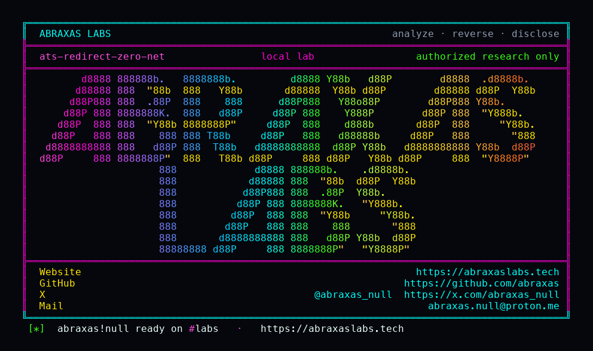

<p align="center">
  
</p>

<p align="center">
  <a href="https://abraxaslabs.tech"><strong>abraxaslabs.tech</strong></a>
  &nbsp;·&nbsp;
  <a href="https://github.com/abraxas">github.com/abraxas</a>
  &nbsp;·&nbsp;
  <a href="https://x.com/abraxas_null">@abraxas_null</a>
  &nbsp;·&nbsp;
  <a href="mailto:abraxas.null@proton.me">abraxas.null@proton.me</a>
  &nbsp;·&nbsp;
  <a href="https://github.com/abraxas/ats-redirect-zero-net">ats-redirect-zero-net</a>
</p>
<p align="center">
  Write-up: <a href="https://abraxaslabs.tech/research/ats-redirect-zero-net"><strong>https://abraxaslabs.tech/research/ats-redirect-zero-net</strong></a>
</p>


# ats-redirect-zero-net

**Class:** SSRF
**Reach:** Remote

**Apache Traffic Server** `10.2.0` (`b1df7334`) - Apache Software Foundation

`redirect.actions` default `routable:follow` classifies `0.0.0.0/8` (except `INADDR_ANY`) as FOLLOW. Loopback is only `127.0.0.0/8` and `::1`. Default CONNECT dest deny and ESI `IncludeUrlValidator` already reject `0.0.0.0/8`. Follow-redirect re-opens it.

Default `number_of_redirections` is 0, so the map is not evaluated until follow is on. A loaded plugin that calls `TSHttpTxnRedirectUrlSet` still forces one hop even when the counter is 0 (CVE-2026-58189 counter reset is closed).

| | |
|---|---|
| ID | no CVE yet |
| Class | **SSRF** (follow-redirect misses `0.0.0.0/8`) |
| Reach | **Remote** (origin `Location` after follow is on) |
| CWE | [CWE-918](https://cwe.mitre.org/data/definitions/918.html) |
| CVSS | **High: 8.6** `CVSS:3.1/AV:N/AC:L/PR:N/UI:N/S:C/C:H/I:N/A:N` |
| Product | [Apache Traffic Server](https://github.com/apache/trafficserver) |
| Affected | **10.2.0** (`b1df7334b39a878971c376da849e8da4984918b6`) `redirect.actions` routable fill |
| Auth | none. Follow must be on (`number_of_redirections=1` in the lab). |
| License | [GNU Affero GPL v3.0](LICENSE) |
| Lab | `127.0.0.1:18790` only |

I pinned public tag [10.2.0](https://github.com/apache/trafficserver/releases/tag/10.2.0) peel [b1df7334](https://github.com/apache/trafficserver/commit/b1df7334b39a878971c376da849e8da4984918b6). The lab is a source-built `ats-10.2.0-lab:local` reverse proxy on loopback. Loopback RETURN. `0.0.0.0` 400. `0.0.0.1` FOLLOW. Remap skipped on the follow hop.

## What an attacker can do

Have ATS follow `Location: http://0.0.0.1/` after `number_of_redirections=1` (or after a plugin `TSHttpTxnRedirectUrlSet`). On Linux, `0.0.0.1` is local.

| Method | Sink | Privilege |
|---|---|---|
| Unauth GET; origin 302 `Location: http://0.0.0.1:18080/w` with `number_of_redirections=1` | `parse_redirect_actions` ROUTABLE fill ([`HttpConfig.cc:1782-1787`](https://github.com/apache/trafficserver/blob/b1df7334b39a878971c376da849e8da4984918b6/src/proxy/http/HttpConfig.cc#L1782-L1787)); OSDNSLookup action map | **Recon / SSRF (lab-proven):** ATS follows as ROUTABLE. Client body `ATS-REDIRECT-ZERO-NET-WITNESS`. Remap skipped on the follow hop. |
| Same hop; `Authorization` / `Cookie` copied | `HttpSM::redirect_request` | **Integrity (inferred):** those headers are not stripped on the follow hop. Not exercised as a write. |
| IPv4-mapped `::ffff:0:0/96` | same fill of `::/0` | **Recon (inferred):** sibling of CONNECT dest deny. Not exercised. |

**Lab-proven vs inferred:** follow `0.0.0.1`, loopback RETURN, routable FOLLOW, `INADDR_ANY` 400 are lab. IPv4-mapped and credential forward are inferred.

**Requires:** `redirect.actions` `routable:follow` (compiled default) and `number_of_redirections > 0`, or a plugin that sets a redirect URL. Default counter is 0.

## Adjacent surface that stays closed

| Surface | Lab |
|---|---|
| Loopback `127.0.0.1` | RETURN. Client never saw `LOOPBACK-ONLY-SECRET`. Stayed 302. |
| `0.0.0.0` INADDR_ANY | 400 before the action map |
| Default `number_of_redirections=0` | `routable:follow` unevaluated |
| RFC1918 / CGNAT / link-local / `::1` | RETURN via the DEFAULT fill |
| CONNECT dest deny `0.0.0.0/8` | already in default `ip_allow.yaml` |
| ESI include validator `0.0.0.0/8` | already private (CVE-2026-58178) |
| Plugin redirect counter reset | closed (CVE-2026-58189) |

Not CVE-2026-58189. Not CVE-2026-58178. Those ranges were named on CONNECT and ESI. Follow-redirect did not get them.

## Lab

```bash
python3 ats-redirect-zero-net-Abraxas-Labs.py
```

or

```bash
cd lab
./run.sh
```

Loopback `127.0.0.1:18790`. Compose project `ats-redirect-zero-net`. Image `ats-10.2.0-lab:local`. Witness `ATS-REDIRECT-ZERO-NET-WITNESS`. Last line:

```
SUCCESS ats-redirect-zero-net follow-0.0.0.1=yes loopback-return=yes routable-follow=yes inaddr-any=400 remap_required=1 ATS-REDIRECT-ZERO-NET-WITNESS
```

## The fix

Mark `0.0.0.0/8` and IPv4-mapped `::ffff:0:0/96` the same way default CONNECT dest deny and ESI `IncludeUrlValidator` already do. Loopback is not only `127/8`. `ats_is_ip_any` rejecting `0.0.0.0` is not enough.

Until then, leave `number_of_redirections` at 0, or set `redirect.actions` so routable is RETURN. A plugin `TSHttpTxnRedirectUrlSet` still forces one hop.

## References

- [github.com/apache/trafficserver](https://github.com/apache/trafficserver) tag [10.2.0](https://github.com/apache/trafficserver/releases/tag/10.2.0) (`b1df7334b39a878971c376da849e8da4984918b6`)
- [`src/proxy/http/HttpConfig.cc`](https://github.com/apache/trafficserver/blob/b1df7334b39a878971c376da849e8da4984918b6/src/proxy/http/HttpConfig.cc) `parse_redirect_actions`
- [`src/records/RecordsConfig.cc`](https://github.com/apache/trafficserver/blob/b1df7334b39a878971c376da849e8da4984918b6/src/records/RecordsConfig.cc) `number_of_redirections` / `redirect.actions`
- [`src/api/InkAPI.cc`](https://github.com/apache/trafficserver/blob/b1df7334b39a878971c376da849e8da4984918b6/src/api/InkAPI.cc) `TSHttpTxnRedirectUrlSet` one-hop bump
- Default CONNECT dest deny: [`configs/ip_allow.yaml.default`](https://github.com/apache/trafficserver/blob/b1df7334b39a878971c376da849e8da4984918b6/configs/ip_allow.yaml.default)
- ESI contrast: `IncludeUrlValidator` `0.0.0.0/8` private (CVE-2026-58178)
- [CWE-918](https://cwe.mitre.org/data/definitions/918.html)
